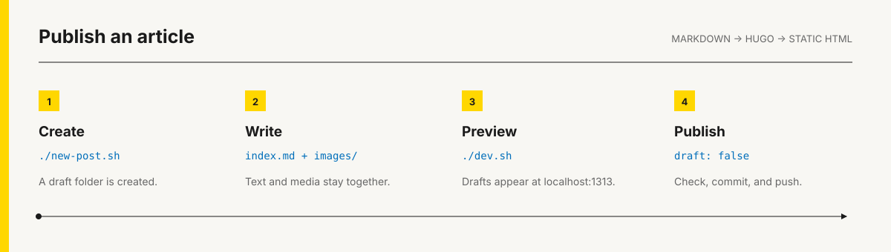

# Hugo Blog Template

A self-hosted blog built with Hugo and Markdown. Includes local search, dark mode, SEO, RSS, image helpers, and optional comments and newsletters.

[Live demo](https://blog.nischal.fyi) · [Use this template](https://github.com/new?template_name=blogs&template_owner=RexO77) · [Documentation](docs/README.md)



## Quick start

Create a repository with **Use this template**, then clone your copy:

```bash
git clone https://github.com/YOUR-USERNAME/YOUR-REPOSITORY.git
cd YOUR-REPOSITORY
npm ci
./dev.sh
```

Open `http://localhost:1313`.

Requires Node.js 20+ and [Hugo Extended](docs/getting-started.md#install-hugo) 0.156.0+.

## Configure

Edit `hugo.toml`:

```toml
baseURL = "https://blog.example.com/"
title = "My Blog"

[params]
  author = "Your Name"
  description = "What this blog is about."
  heroHeadline = "A BLOG ABOUT <em>WHAT MATTERS.</em>"
```

See [Getting Started](docs/getting-started.md) for profile, social, SEO, comments, and newsletter settings.

## Write

```bash
./new-post.sh
```

Or skip the prompts:

```bash
./new-post.sh "My First Article"
```

```text
content/posts/my-first-article/
├── index.md
└── images/
```

Write in `index.md`, preview with `./dev.sh`, and set `draft: false` when the article is ready. The [Writing Guide](WRITING-GUIDE.md) covers front matter and images.

## Deploy


| Setting | Value |
| --- | --- |
| Install | `npm ci` |
| Build | `./build.sh` |
| Output | `public` |
| Runtime | Node 20 · Hugo 0.156.0+ |

Vercel and Netlify configuration is included. Cloudflare Pages, GitHub Pages, and other static hosts are covered in the [Deployment Guide](docs/deployment.md).

Before publishing:

```bash
npm run check
```

## Documentation

- [Getting Started](docs/getting-started.md) — install and configure
- [Writing Guide](WRITING-GUIDE.md) — create and publish articles
- [Hugo Reference](docs/hugo-guide.md) — understand this template
- [Deployment Guide](docs/deployment.md) — put it online

## License

[Apache 2.0](LICENSE). You are responsible for the rights to content and assets you publish.
