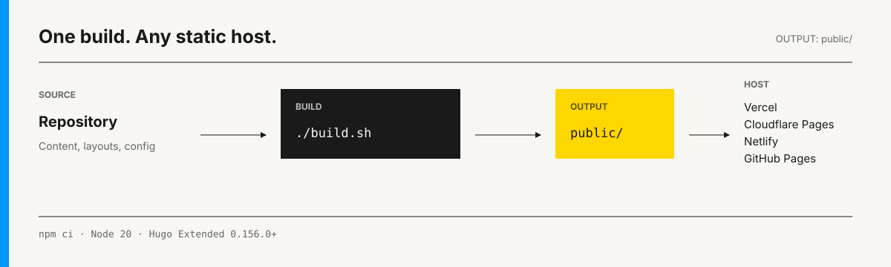

# Deployment Guide



## Build settings

Every host uses the same output:

| Setting | Value |
| --- | --- |
| Root directory | `/` |
| Install command | `npm ci` |
| Build command | `./build.sh` |
| Output directory | `public` |
| Node.js | `20` |
| Hugo Extended | `0.156.0` or newer |

Use `./build.sh`, not plain `hugo`; the script also builds search and checks production URLs.

Set `baseURL` in `hugo.toml` to the permanent production URL before the final deployment.

## Choose a host

| Host | Included setup |
| --- | --- |
| Vercel | `vercel.json` |
| Netlify | `netlify.toml` |
| Cloudflare Pages | Build settings below |
| GitHub Pages | Workflow template below |
| Other static host | Upload `public/` |

Provider plans and limits change. Check current terms when free-tier limits matter.

## Vercel

1. Import the repository into Vercel.
2. Keep the repository root as the project root.
3. Confirm that Vercel reads `./build.sh` and `public` from `vercel.json`.
4. Deploy.

Git pushes create deployments; non-production branches receive preview URLs.

[Vercel deployment reference](https://vercel.com/docs/deployments/overview)

## Cloudflare Pages

In **Workers & Pages**, import the Git repository and use:

| Field | Value |
| --- | --- |
| Production branch | `main` |
| Build command | `./build.sh` |
| Build output | `public` |
| Root directory | `/` |

Add these environment variables to Production and Preview:

```text
HUGO_VERSION=0.156.0
NODE_VERSION=20
```

Deploy, then use the assigned `*.pages.dev` URL or connect a custom domain.

[Cloudflare Hugo guide](https://developers.cloudflare.com/pages/framework-guides/deploy-a-hugo-site/)

## Netlify

1. Import the repository into Netlify.
2. Confirm that `netlify.toml` supplies `./build.sh` and `public`.
3. Deploy.
4. Use the assigned `*.netlify.app` URL or connect a custom domain.

[Netlify Hugo guide](https://docs.netlify.com/build/frameworks/framework-setup-guides/hugo/)

## GitHub Pages

Choose the correct `baseURL`:

```text
User site       https://USERNAME.github.io/
Project site    https://USERNAME.github.io/REPOSITORY/
Custom domain   https://blog.example.com/
```

Copy [examples/github-pages.yml](examples/github-pages.yml) to:

```text
.github/workflows/deploy-pages.yml
```

Then open **Settings → Pages → Build and deployment** and select **GitHub Actions**.

[GitHub Pages workflow reference](https://docs.github.com/en/pages/getting-started-with-github-pages/using-custom-workflows-with-github-pages)

## Other static hosts

Build locally:

```bash
npm ci
npm run check
```

Upload the contents of `public/` to the host’s web root. `index.html` should be at the root, not inside another `public/` folder.

## Custom domain

1. Add the domain in the host’s dashboard.
2. Apply the DNS records supplied by that host.
3. Wait for HTTPS to become active.
4. Update `baseURL` to the exact final URL.
5. Run `npm run check` and deploy again.

Do not copy DNS values from another project or tutorial.

## If deployment fails

| Symptom | Check |
| --- | --- |
| Hugo or Node version error | Pin the versions from the build-settings table |
| Pagefind search is missing | Ensure the build command is `./build.sh` |
| Localhost or placeholder URL | Correct `baseURL` in `hugo.toml` |
| GitHub Pages assets are missing | Include the repository path in `baseURL` |
| Build succeeds but site is blank | Set the output directory to `public` |
| Draft is absent | Set `draft: false` and check the article date |

Reproduce hosted failures locally with `npm ci && npm run check`, then compare the provider build log.

[Documentation](README.md) · [Hugo Reference](hugo-guide.md)
